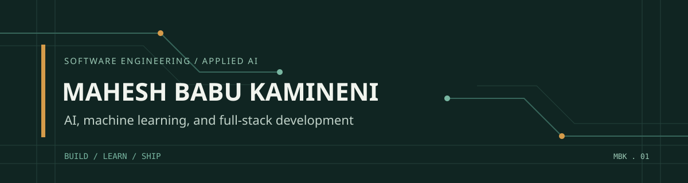

  

  
  
  

## About

Software engineer working across applied AI, machine learning, and full-stack development. I enjoy turning ideas into useful, well-structured software and exploring how language models can make applications more capable.

## Current interests

- Generative AI applications and LangGraph workflows
- Transformers and recommendation systems
- Reliable backend services and practical developer tooling

## Selected work

| Project | What it explores |
| --- | --- |
| [Langgraph Path](https://github.com/MaheshBabuKamineni/Langgraph_Path) | Learning projects and experiments with LangGraph |
| [GuardRails](https://github.com/MaheshBabuKamineni/GuardRails-) | Guardrails and reliability for AI applications |
| [Pydantic Logfire](https://github.com/MaheshBabuKamineni/PYDantic-LogFire-) | Experiments with Pydantic and Logfire |

## Toolkit

---

Building thoughtful software, one useful experiment at a time.

